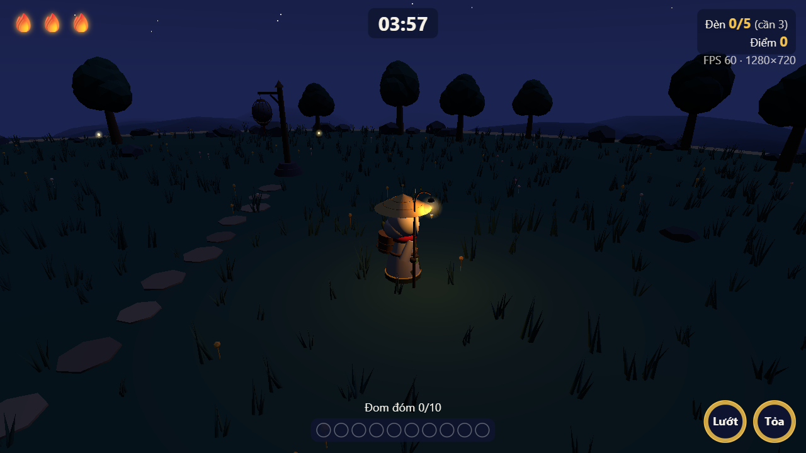
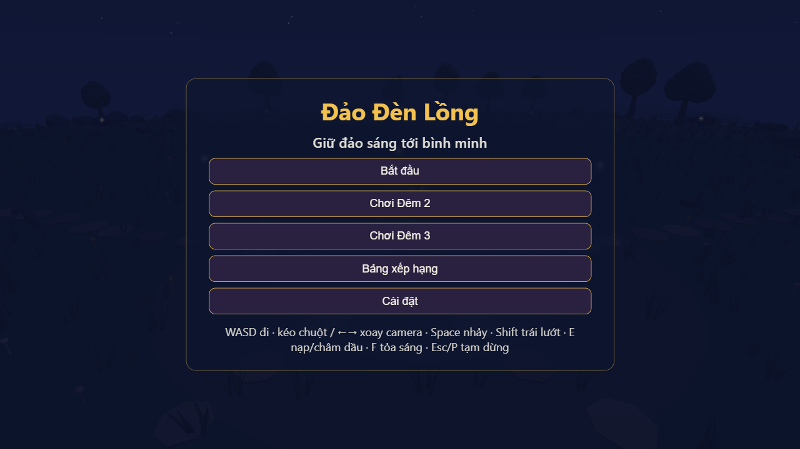
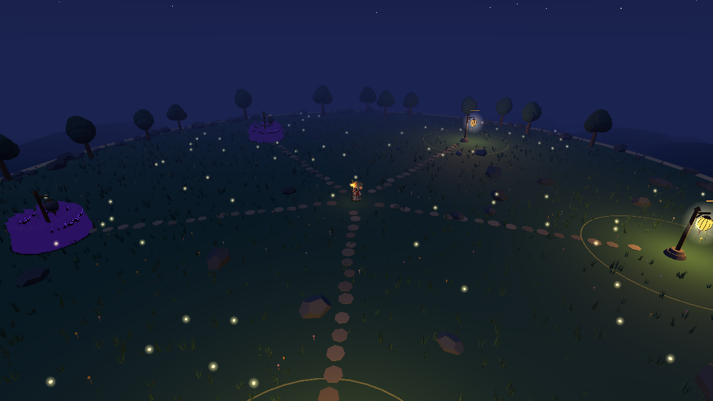

# Đảo Đèn Lồng

> **Video demo:** _link added with Release v1.0.0_ · **Release:** [v1.0.0](../../releases/tag/v1.0.0) · Specs: [Phase 1](docs/specs/phase-1-PRD-0.md) · [Phase 2](docs/specs/phase-2-TICKET-02.md) · [Phase 3](docs/specs/phase-3-TICKET-03.md) · [Phase 4](docs/specs/phase-4-TICKET-04.md) · [CHANGELOG](CHANGELOG.md) · [Retro](docs/RETRO.md) · Lab docs: [docs/lab/](docs/lab/README.md)

A small 3D third-person night game. You are **Mây**, a young lantern keeper in a nón lá. Collect fireflies, light the Great Lanterns and keep them fuelled, and drive back the Ink Shades (Bóng Mực) that drain weak lanterns. **Keep enough of the island lit until dawn** across three nights: Đảo Bến, Đảo Cau, Đảo Chuông.



| Menu | Benchmark scene (200 shades, 100 fireflies) |
|---|---|
|  |  |

## System requirements

- **Node.js ≥ 20.19** (tested on Node 24) and npm. macOS, Linux or Windows.
- A browser with WebGL2 (any recent Chrome/Edge/Firefox/Safari).
- `npm ci` also downloads a Chrome for Testing build (≈ 170 MB, via puppeteer). It's only used by `bench_cmd` and the screenshot script.

## Install & run (3 commands)

```bash
npm ci
npm run build
npm start          # serves the game at http://127.0.0.1:5180 and opens your browser
```

`npm start` = `node scripts/play.mjs` (the contract's `run_cmd`). It also stores the **leaderboard on disk** in `~/.dao-den-long/leaderboard.json` (set `DDL_DATA_DIR` to change it). Export: `node scripts/play.mjs --export-leaderboard out.json` → `{"entries": [...]}` in ranking order.

## Controls (all rebindable in Settings → Phím)

| Default key | Action |
|---|---|
| W A S D | Move (relative to the camera) |
| ← / → or drag the mouse | Rotate the camera |
| Space | Jump |
| Shift | Dash (14 m/s for 0.2 s, 1.5 s cooldown) |
| E | Light / relight / refuel the nearest lantern within 2 m |
| F | Pulse of light: stuns + pushes shades within 5 m (3 fireflies, 3 s cooldown) |
| P / Esc | Pause (Continue / Replay night / Settings / Menu) |

## Rules & scoring (contract v1.3 = v1.2 rules)

- Nights last 240 / 270 / 300 s. **Win** if Mây is alive at dawn with at least 60 % of the lanterns lit (3/5, 4/6, 5/7). Lose on running out of flames (3 per night) or on a dark dawn.
- Fireflies are picked up within 1 m. You can carry 10 + 2 per lantern lit this night (max 20).
- A lantern needs 10 fireflies the first time (5 to relight). It burns 1 fuel/s from 100; each firefly refuels +10. Below 30 fuel it blinks, loses its 6 m safe zone, and wandering shades come to drain it (5/s each).
- Night 2 adds jump pads, a bamboo bridge, **Gió Lạc** (steals fireflies) and **Bùa Gió** (speed charm). Night 3 adds three tiers, ramps, a bell tower and wind gusts.
- Game total = the sum of the nights you won. It goes on the leaderboard after dawn or after a loss.

| Event | Points |
|---|---|
| Firefly deposited (light / relight / refuel) | +5 |
| First light / relight | +100 / +40 |
| Shade hit by a pulse | +5 (+15 if it was draining) |
| On a win: per lit lantern at dawn / per flame left | +50 + fuel / +50 |

All numbers live in [game.contract.json](game.contract.json) `tuning`; the code reads them from there.

## Accessibility

Settings (saved between sessions):
- Volume and mouse sensitivity.
- **Key rebinding** for all 9 actions. A key already in use is refused, with a message naming the action that has it. "Khôi phục mặc định" resets all keys.
- **Colour-blind palette**: shades #00B3FF, warnings white with ⚠.
- **Reduced motion**: no camera shake, screen flash or blinking UI.
- **Large text** (×1.25). Base UI text is 18 px at 1280×720.

**Subtitles / visual cues** cover: a shade appearing (plus an edge arrow pointing at it), wind about to blow, the last 10 s, a lantern under 30 fuel, a lantern going out, and Gió Lạc stealing.

## Tests, headless, bench, soak

```bash
npm test                     # 77 tests: rules of all 4 tickets, CLI, leaderboard, bench scene, soak, export
npm run proof                # regenerates docs/proof/phase-4 from the real CLI (each case run twice, sha256)
node dist/headless/cli.js --seed 1 --night 1 --ticks 600 --out out.jsonl [--scenario f.json] [--inputs f.json] [--snapshot-every 10]
node scripts/bench.mjs --seed 42 --duration 30 --out bench.json     # bench_cmd (opens a 1280×720 window)
node --expose-gc dist/headless/soak.js --seed 7 --nights 10 --out soak.json   # soak_cmd
node scripts/screenshots.mjs # README screenshots
```

- **Headless** follows Test Contract v1.3 (fixed 60 ticks/s, the 12-step tick order, JSONL). A full night runs in about 0.2 s.
- **Bench**: puppeteer opens Chrome at 1280×720 (device scale 1) with `--disable-gpu-vsync --disable-frame-rate-limit` (vsync off). It loads the fixed scene and flies the camera around the 30 m / Y 15 circle once every 15 s. It warms up 3 s, then measures.
  - The scene: Night 1, 200 wandering shades + 100 fireflies spread by seed 42, L1–L3 lit at 100. Spawns, damage, pickup, fuel loss and the end of the night are off.
  - `peak_mem_mb` is the summed RSS of the browser's process tree.
  - If the bundled Chrome can't start (some Windows policies block it), it falls back to an installed Chrome/Edge, or `CHROME_PATH`.
- **Our numbers** ([bench.json](bench.json), [soak.json](soak.json)) on a laptop (i5-9300H, Intel UHD 630 iGPU, Windows 11):
  - Bench: **avg 80.1 FPS, 1 % low 32.0 FPS, p95 20.5 ms, load 1.6 s, peak 549 MB** (with the detailed environment; 92.1 / 33.6 before it).
  - Soak: **10 nights, 0 crashes, RSS 52 → 57.5 MB** (limit 1.2×).
- Evidence and notes per phase: [docs/proof/](docs/proof/) · [docs/notes/](docs/notes/) · ADR [0001](docs/adr/0001-lantern-fuel-and-dawn-win.md).

## Sáng tạo của tôi

- **Mây's design**: a hooded wanderer with glowing eyes, red scarf, plant basket and a staff whose glass orb shows the fireflies you carry (one light per firefly), plus the PRD's nón lá with a small lantern.
- **Ink Shades** as tattered ink wraiths with glowing eyes. They shrink and fade while stunned, and their eyes turn white while draining.
- **Hội An–style Great Lanterns** that fill with light, with a fuel bar, and torn, squashed paper when out.
- All synthesised sound (Web Audio, no files) and Ông Đăng's lines for each night.
- All of it is visual/audio only. `src/web/` never feeds back into `src/sim`, so headless output is unchanged (proof cases and determinism tests). The bench uses the same models as normal play.

## AI harness

[CLAUDE.md](CLAUDE.md) (agent rules, commands, current phase) · [.claude/settings.json](.claude/settings.json) + [scripts/stop-gate.mjs](scripts/stop-gate.mjs) (Stop hook: the agent can't finish while `npm test` fails) · [.claude/skills/verify-phase](.claude/skills/verify-phase/SKILL.md) (phase verification skill) · [.github/workflows/ci.yml](.github/workflows/ci.yml) (CI: tests + the committed proof must equal the regenerated proof).

License: [MIT](LICENSE) · Credits: [CREDITS.md](CREDITS.md)
